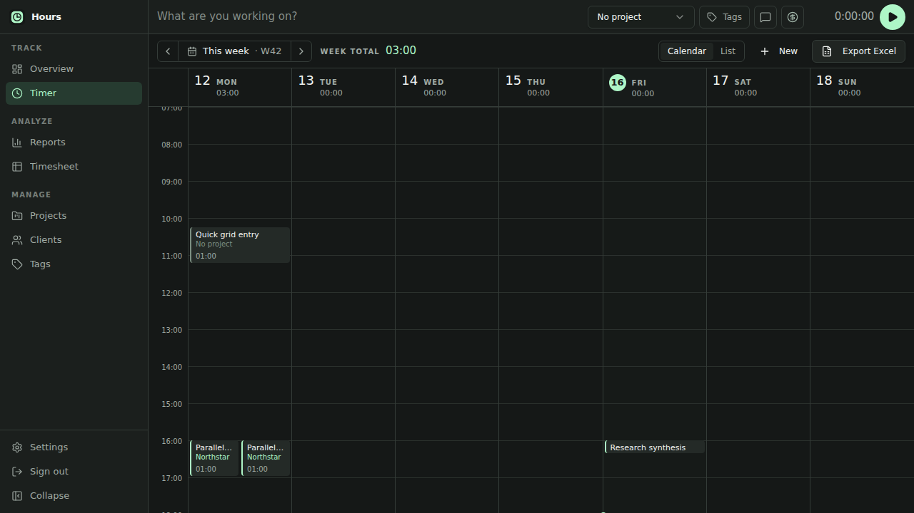
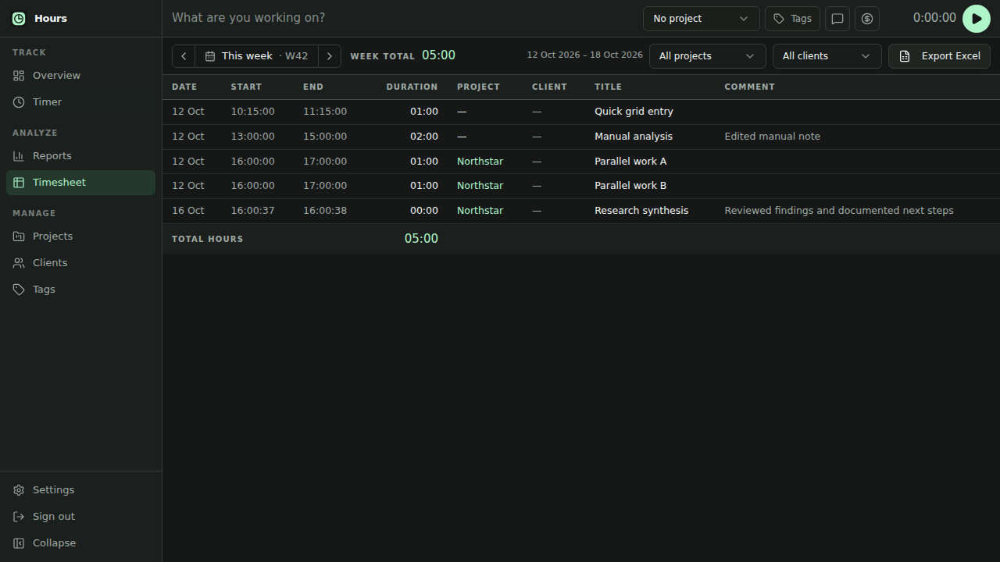
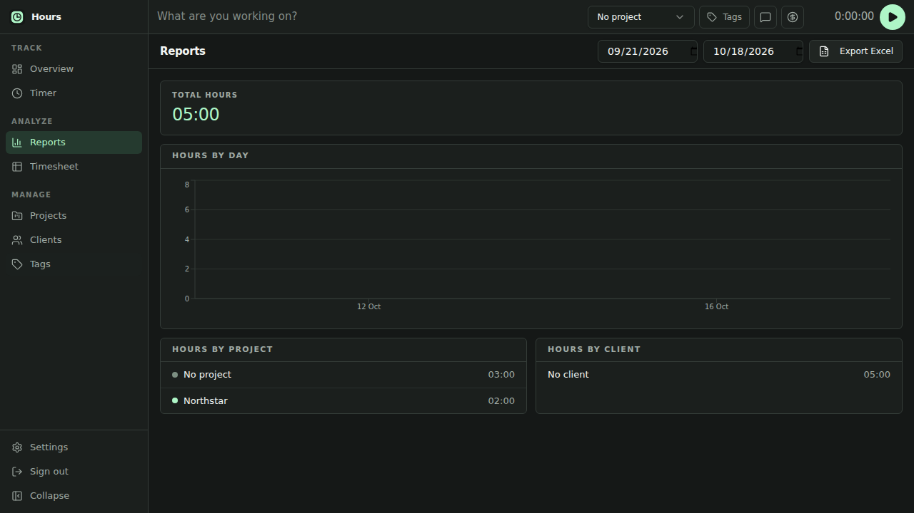

<p align="center">
  
</p>

<h1 align="center">Hours Time Tracker</h1>

<p align="center">
  A local-first Windows time tracker for people who want accurate work logs without another account, subscription, or cloud dashboard.
</p>

<p align="center">
  <a href="https://github.com/Pilvik1/hours-time-tracker/actions/workflows/ci.yml"></a>
  <a href="https://github.com/Pilvik1/hours-time-tracker/actions/workflows/security.yml"></a>
  <a href="https://github.com/Pilvik1/hours-time-tracker/releases"></a>
  <a href="LICENSE"></a>
  
</p>

<p align="center">
  <a href="https://github.com/Pilvik1/hours-time-tracker/releases"><strong>Download for Windows</strong></a>
  ·
  <a href="PRIVACY.md">Privacy</a>
  ·
  <a href="architecture.md">Architecture</a>
  ·
  <a href="CONTRIBUTING.md">Contributing</a>
</p>

> **Status:** beta. The desktop application is functional and release-gated, but Windows binaries are not yet code-signed and may trigger a Microsoft SmartScreen warning.

## See your week, not another SaaS dashboard



| Timesheet and XLSX export | Reports by day, project, and client |
| --- | --- |
|  |  |

All screenshots use generated example data. No real work records are included in this repository.

## What it does

- Starts and stops a persistent timer from the desktop header
- Creates a one-hour entry with one calendar click
- Supports drag, resize, duplicate, edit, and delete workflows
- Displays overlapping entries in deterministic side-by-side lanes
- Organizes work by projects, clients, and tags
- Reports exact or rounded hours by day, project, and client
- Exports employer-ready XLSX timesheets
- Preserves local data across application and machine restarts
- Ships as both a Windows installer and a portable executable

## Download and run

1. Open [GitHub Releases](https://github.com/Pilvik1/hours-time-tracker/releases).
2. Download `Hours.Setup.<version>.exe` for the installer or `Hours.<version>.Portable.exe` for the portable build.
3. Compare the file's SHA-256 hash with `SHA256SUMS.txt` from the same release.
4. Launch the application. If SmartScreen appears, verify the filename and checksum before choosing whether to continue.

The packaged desktop app does **not** require Python, Node.js, Docker, PostgreSQL, an account, or an internet connection.

## Local-first by design

- Time entries, timer state, projects, clients, tags, and settings live in a local SQLite database under the Windows user-data directory.
- The application starts two internal HTTP services on random ports bound only to `127.0.0.1`.
- Separate cryptographically random credentials protect the frontend and backend on every launch.
- There is no telemetry, advertising, crash-report upload, cloud sync, or external AI service.
- Data leaves the application only when the user explicitly exports a workbook or copies information through normal operating-system features.
- Uninstalling the application does not intentionally remove the user-data directory.

Read [PRIVACY.md](PRIVACY.md) for the complete data-flow statement and [SECURITY.md](SECURITY.md) for vulnerability reporting.

## Architecture

```text
Electron desktop supervisor
  ├── local TanStack Start server (127.0.0.1, random port)
  │     └── same-origin /api proxy with an internal token
  └── bundled FastAPI executable (127.0.0.1, random port)
        └── SQLite database in the Windows user-data directory
```

Electron starts both services, waits for health checks, sets an HTTP-only per-launch cookie, opens the window only after readiness, records startup logs, and stops its child processes on exit. FastAPI remains authoritative for validation, time calculations, persistence, reporting, and spreadsheet generation.

The repository also retains a Docker/PostgreSQL stack for local web development and container CI. It is separate from the downloadable desktop release and is not configured for hosted deployment.

See [architecture.md](architecture.md) for component ownership and trust boundaries.

## Development

### Requirements

- Node.js 24
- Python 3.12+
- Docker with Compose only for the optional web/PostgreSQL path

### Install

```bash
npm ci
npm --prefix frontend ci
python -m venv .venv
.venv/bin/pip install -e 'backend[dev]' -r backend/build-requirements.txt
```

On Windows, replace `.venv/bin/` with `.venv\Scripts\`.

### Validate

```bash
.venv/bin/ruff format --check backend
.venv/bin/ruff check backend
.venv/bin/pytest backend/tests --cov=time_tracker --cov-fail-under=75
npm audit --audit-level=high

cd frontend
npm run typecheck
npm test
npm run lint
npm run build
npm audit
```

### Package

```bash
npm run frontend:build:desktop
.venv/bin/pyinstaller --noconfirm --clean \
  --distpath backend-dist \
  --workpath build/pyinstaller \
  backend/hours-backend.spec
npm run desktop:pack
```

Windows artifacts are built and runtime-tested by [the release workflow](.github/workflows/desktop-release.yml). A package produced on another operating system is not a substitute for the Windows CI gate.

### Optional local web stack

```bash
cp .env.example .env
# Replace every placeholder secret before starting the stack.
docker compose up --build
```

Open <http://localhost:3000>. This development path uses PostgreSQL and password authentication.

## Repository guide

- [CHANGELOG.md](CHANGELOG.md) — released behavior and notable changes
- [ROADMAP.md](ROADMAP.md) — near-term product and release priorities
- [architecture.md](architecture.md) — runtime, ownership, and security boundaries
- [CONTRIBUTING.md](CONTRIBUTING.md) — development workflow and DCO
- [SECURITY.md](SECURITY.md) — supported versions and private reporting
- [PRIVACY.md](PRIVACY.md) — local storage and network behavior
- [THIRD_PARTY_NOTICES.md](THIRD_PARTY_NOTICES.md) — dependency and redistribution notes
- [BRANDING.md](BRANDING.md) — project-name and affiliation statement

## Contributing

Focused bug fixes, tests, documentation, and maintainability improvements are welcome. Substantial behavior or architecture changes should begin with an issue. All commits must include a Developer Certificate of Origin sign-off as described in [CONTRIBUTING.md](CONTRIBUTING.md).

## License

Copyright © 2026 Håkon Pilvik.

The software is licensed under the [GNU Affero General Public License v3.0 only](LICENSE). Commercial use is permitted; the license's source-sharing obligations still apply. Third-party components remain under their respective licenses and every release includes an SPDX SBOM.

The repository name is descriptive working identification, not a representation of affiliation with similarly named products. See [BRANDING.md](BRANDING.md).
